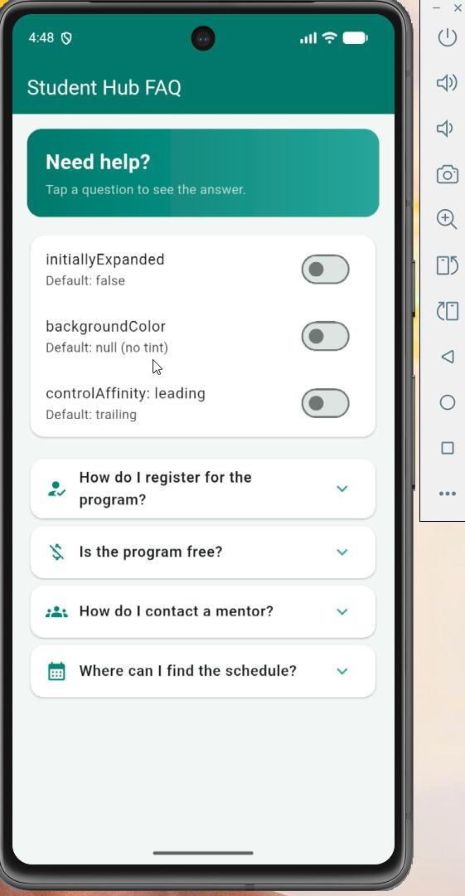

1. Student Hub FAQ – ExpansionTile Flutter Demo

2. About the Project

Student Hub FAQ is a basic Flutter app that shows how to use the `expansion_tile` widget.

This application presents commonly asked questions about a Student Program. The users can click on each question to view the answer. They can also set three attributes of the `ExpansionTile` widget via switch.

3. Objectives

Discover how to use the Flutter `ExpansionTile` widget.
- Show questions and answers in an orderly fashion.
- Be able to change the properties of widgets with switches.
- Work on creating an interactive UI interface using flutter.

4.Features

Answers questions and provides solutions to common problems.
- Provides a user ability to open and close questions.
- Has a colored header.
- Offers switches to regulate 3 properties of `ExpansionTile`.
- Organises content using cards and list layout.

5. Three Properties Demonstrated

5.1. `initiallyExpanded`

Acts as controller for whether an expansion tile is open or closed in the initial appearance.

true: Tile is opened on start.
- `false`: The tile starts closed.

5.2. `backgroundColor`

Adds control to control background color of the tile when expanded.

If activated, the background color is light teal.
If disabled, then no custom background color will be applied.

5.3. `controlAffinity`

Moves the expansion arrow.

- `ListTileControlAffinity.leading`: This will position the arrow on the left.
- `ListTileControlAffinity.trailing`: The arrow is shown on the right.

6.Technologies Used

- **Flutter** – to create user interface.
Flutter is written in the language Dart.
- **Material Design** – widgets and styling of the application.

7 Requirements

The following is required to implement this project.

- Flutter SDK
This is included with Dart SDK (which is included in Flutter).
Android Studio or Visual Studio Code.
An Android emulator or connected Android phone

8. How to Run the Project

8.1. Clone this repository:

   ```bash
   git clone https://github.com/mmukamukiza21/expansion_tile_app.git
   ```

9. Double click on the project folder:

   ```bash
   cd expansion_tile_app
   ```

10. Install the project requirements:

   ```bash
   flutter pub get
   ```

Check the connected devices:

   ```bash
   flutter devices
   ```

11. Run the application on your android emulator:

   ```bash
   flutter run
   ```

12. What I Learned

In this project, I used the widget “ExpansionTile” and understood the different properties that affects the look and functionality of an application. I also used StatefulWidget, SwitchListTile, Card, Container, and ListView to build an interactive interface for users.

 Author

Milliam Mukamukiza
 Repository

Look at the project on Github: https://github.com/mmukamukiza21/expansion_tile_app
## Screenshot

## Screenshot


